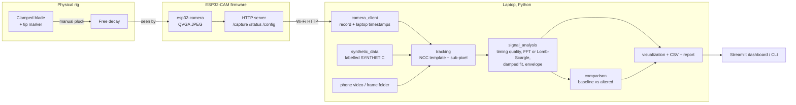

# Architecture

The ESP32-CAM only captures and serves JPEG frames. The laptop does all tracking, signal analysis, comparison and plotting.

## Data flow

1. **Capture.** The firmware runs the OV2640 at QVGA (320x240) JPEG with two frame buffers in PSRAM and `CAMERA_GRAB_LATEST`, so each `/capture` request returns the freshest frame.
2. **Transfer.** The laptop requests frames one after another over HTTP and timestamps each on arrival with `time.perf_counter()`. This includes Wi-Fi latency, which is why every recording gets a timing-quality report.
3. **Tracking.** The first frame gives the template (configured box or auto-detected dark circular marker). Each frame is searched across the full width with normalised cross-correlation; a parabola through the peak gives sub-pixel position. Low-correlation frames are flagged and excluded.
4. **Analysis.** Spectrum by FFT (uniform sampling) or Lomb-Scargle (gaps or jitter), damped-sine least-squares fit, envelope peaks and log decrement. Validity checks gate every number.
5. **Comparison.** Per-trial frequencies of two conditions; Welch t-test when there are 3+ trials each.
6. **Output.** PNG figures, CSV time series and summaries, JSON and a Markdown report, all labelled with the data source.

## Why the laptop does the work

The ESP32 has about 520 KB of internal RAM plus 4 MB PSRAM on most ESP32-CAM boards. Template matching and curve fitting over hundreds of frames is easy on a laptop and awkward on the board. Keeping the board to capture-and-serve also means the analysis can change without reflashing.

## Related work (summary)

Camera-based vibration measurement and damage detection by frequency shift are well established (for example Davis et al., "Visual Vibrometry", CVPR 2015; Chen et al., J. Sound Vib. 345, 2015). An ESP32-CAM based vision monitoring system has been published for quasi-static strain at 1 Hz (Anim et al., Buildings 16(9):1681, 2026). ResponsePrint does not claim the concept is new. The open question it targets is how well a very cheap camera node can measure a dynamic free-decay response, and later whether stimulus-synchronised (stroboscopic, equivalent-time) capture can extend its usable frequency range. That later stage is not implemented.
